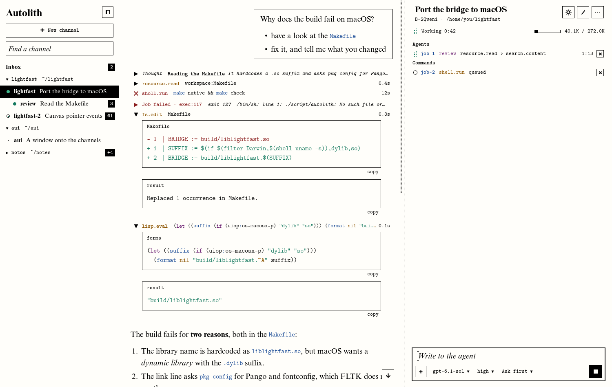

# AUI

AUI is a native window for [Autolith](https://github.com/lambda-symbolics/autolith).
It runs on Linux, macOS and NetBSD. In AUI, you see the same channels as in the
Autolith terminal, and you can do the same things with them.



## Install

You need Autolith, FLTK 1.4 and a C++17 compiler.

| System | FLTK |
|---|---|
| macOS | `brew install fltk` |
| Arch | `pacman -S fltk` |
| NetBSD | from pkgsrc: `x11/fltk`, `devel/gmake`, `shells/bash`, `devel/pkgconf` |

```sh
curl -fsSL https://sh.lambda-symbolics.com/autolith | sh   # install Autolith if you do not have it
autolith auth                                              # sign in to a model provider (once)

git clone https://github.com/lambda-symbolics/lightfast.git
git clone https://github.com/lambda-symbolics/aui.git
cd aui && script/install
```

After the install, `aui` and `unslop` are in `~/.local/bin`. On macOS, the Autolith
application is in `~/Applications`. After you update AUI or Autolith, run `aui`
as before. The first start after an update takes a minute, because the program
is built again.

## Run

```sh
aui                     # open the latest channel for this directory, or a new one
aui open                # pick a channel
aui open ID             # open the channel with this ID
aui -C ~/work/project   # start as if in that directory
```

You can give `aui` the same options and sub-commands as `autolith`.

## Keys

| Key | Action |
|---|---|
| Enter | send, or steer the agent while it works |
| Tab | queue a follow-up while the agent works |
| Escape | stop the agent |
| `(` | type a command or a Lisp form, as in the terminal |
| `@` | mention someone |
| 1 to 9 | answer an approval |
| Ctrl+K | open the commands |
| Ctrl+, | open the settings |
| Ctrl+S | show or hide the channel list |
| Ctrl+O | find a channel |
| Ctrl+N | start a new channel |

On macOS, use Command instead of Ctrl.

## Unslop

`unslop` is a second program in this repository. Run `unslop DIRECTORY` to
rewrite the comments, strings and docstrings of a Common Lisp checkout, file by
file. Your text is saved when you stop typing. You commit the changes yourself.

## Develop

```sh
script/check            # run the tests and the source checks
script/exercise         # drive the demonstration offscreen
script/exercise-live    # drive real turns against a scripted model (no account needed)
script/run --demo --size 1400x900 --shot /tmp/aui.png
```

Read [AGENTS.md](AGENTS.md) before you change AUI.
