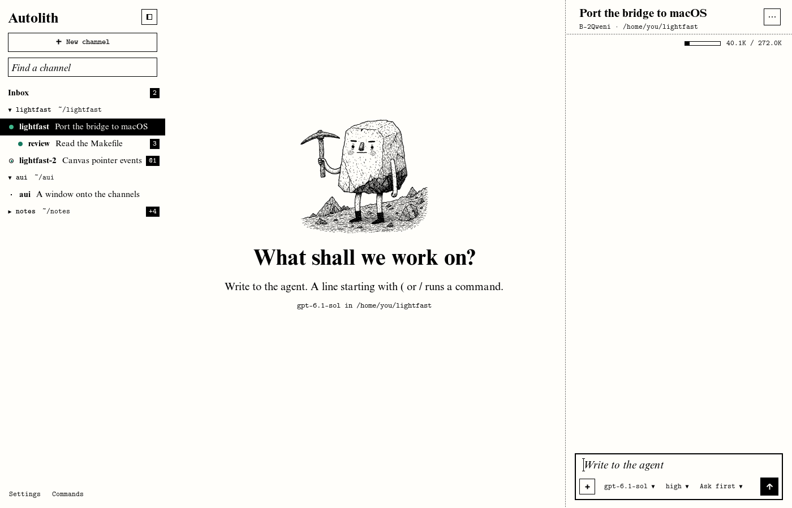
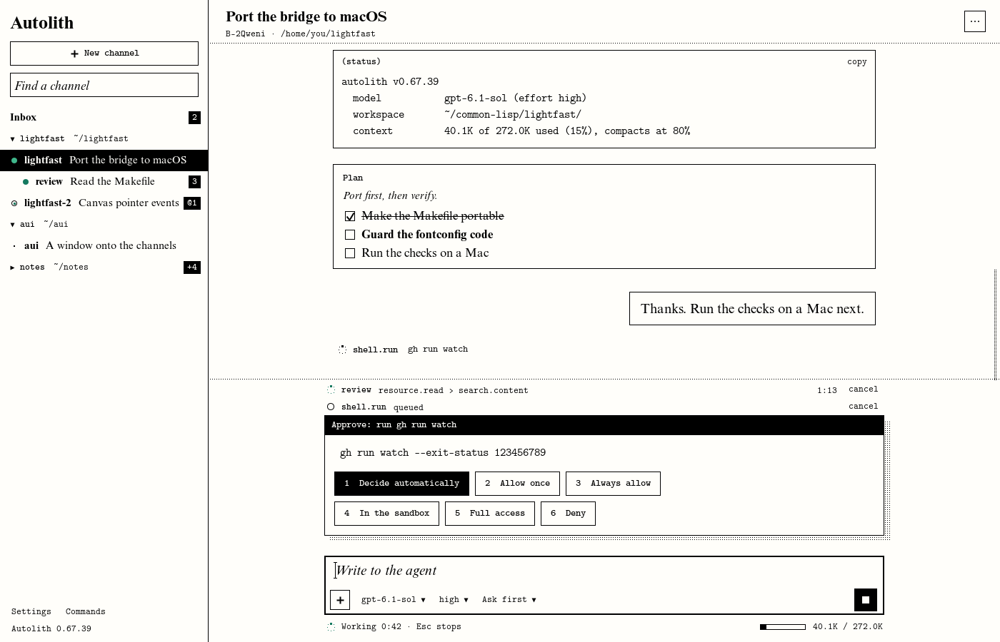
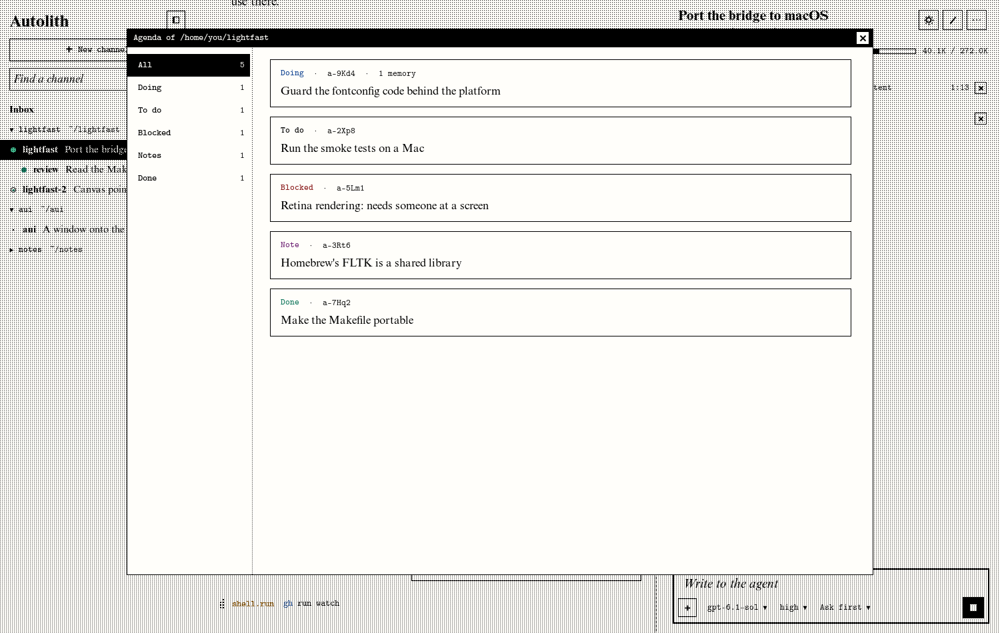
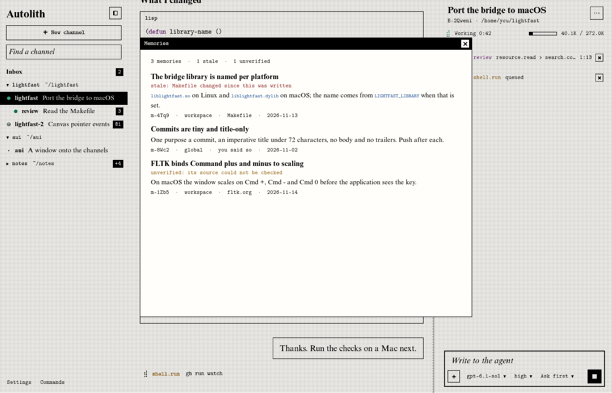

# AUI

A native window onto [Autolith](https://github.com/lambda-symbolics/autolith)'s
world of channels, written in Common Lisp on
[Lightfast](https://github.com/lambda-symbolics/lightfast) and FLTK 1.4. It runs
on Linux, macOS and NetBSD.

AUI is a client of Autolith's world server, as Autolith's terminal is. It
uses Autolith's own client code to open channels, to follow them and to list
them. Whatever you can reach from the terminal, you can reach from the window.

The look is Interlisp Paper's and the Autolith site's: paper, black ink, Times
for what is said, a typewriter face for what is said about it, inversion
instead of grey, dither as the only tone between, hairlines, square corners,
and a few accent inks.










## Install

AUI is built on the machine it runs on, against the Autolith installed there.

1. Install Autolith, so that `autolith` is on your path. From a release:

   ```sh
   curl -fsSL https://sh.lambda-symbolics.com/autolith | sh
   ```

   A release brings Autolith's source, its pinned libraries and an SBCL of
   its own, and AUI builds against those. A source checkout that has run its
   `script/bootstrap` serves the same way.
2. Install FLTK 1.4 and a C++17 compiler. On macOS: `brew install fltk`. On
   Arch: `pacman -S fltk`. On NetBSD, from pkgsrc: `x11/fltk`, with
   `devel/gmake`, `shells/bash` and `devel/pkgconf` for the build.
3. Clone Lightfast beside AUI:

   ```sh
   git clone https://github.com/lambda-symbolics/lightfast.git
   git clone https://github.com/lambda-symbolics/aui.git
   ```

4. Build and install:

   ```sh
   cd aui
   script/install
   ```

`script/install` builds Lightfast's native bridge and the saved image
`build/aui`, links `aui` into `~/.local/bin`, and on macOS also makes
`~/Applications/Autolith.app` for the Dock and Spotlight. The image holds the
client code of the Autolith it was built against. After updating AUI,
Lightfast or Autolith, run `aui` again: the launcher builds the image again
when its sources are newer or another Autolith is installed.

`AUI_AUTOLITH_ROOT` names Autolith's release directory or its checkout when
`autolith` is not on the path, and `AUI_LIGHTFAST_ROOT` names Lightfast when
it is not beside AUI.

On a Mac with Homebrew, from nothing, with Autolith from its release. The
macOS check in `.github/workflows/check.yml` runs these steps on every push,
and a second time with Autolith built from source:

```sh
brew install fltk
curl -fsSL https://sh.lambda-symbolics.com/autolith | sh
export PATH="$HOME/.local/bin:$PATH"
autolith auth                 # sign in to a model provider, once

git clone https://github.com/lambda-symbolics/lightfast.git
git clone https://github.com/lambda-symbolics/aui.git
(cd aui && script/install)
```

After that, Autolith is in `~/Applications`, and `aui` is on the path.

## Run

`aui` takes `autolith`'s command line.

```sh
aui                          # the latest channel for this directory, or a new one
aui open ID                  # a specific channel, by identifier or a part of it
aui open                     # no channel yet: pick one from the list
aui --model MODEL --permissions auto
aui -C ~/work/project        # as if started in that directory
aui status                   # every other sub-command runs as under autolith
```

If no world server is running, the first `aui` starts one with
`autolith start`, so it is the server a terminal would start. The options for a channel (`--model`, `--provider`,
`--permissions`, `--immutable`, `--image`, `--site-config-root`) are
Autolith's own and mean what they mean there. A start without a window
(`--detached`, `--pristine`) and every sub-command except `open` run in
`autolith` itself: `aui` turns into it.

Options of AUI's own:

| option | meaning |
|---|---|
| `-C`, `--directory DIR` | work in DIR instead of the current directory |
| `--prompt TEXT` | send TEXT as soon as the channel is attached |
| `--draft TEXT` | put TEXT in the composer |
| `--view NAME` | show `commands`, `settings`, `channels`, `agenda`, `memories` or `plan` at start |
| `--demo` | a scripted conversation, no server needed |
| `--shot FILE` | write a picture of the window and exit |
| `--size WIDTHxHEIGHT` | with `--shot`, draw offscreen at exactly this size |

## Using it

A wide window has three columns:

- On the left, the list of channels.
- In the middle, the conversation. Under it you write: the composer, an
  approval when one is asked for, the messages that wait, and one line that
  says whether the agent is working and how full its context is.
- On the right, the console: the channel's title, identifier and folder, what
  is running, and under that three parts read from the conversation. The plan
  is the agent's latest, with the step in hand set apart. The files are the
  ones the agent changed, linked or named; click one to open it. The messages
  are what was sent to the agent, as a table of contents; click one to see it
  in the conversation. Click a part's name to put the part away or bring it
  back.

Drag the edge between the conversation and the console to resize the console.
The width is remembered. In a narrower window the title is above the
conversation and what is running is above the composer. In a window too
narrow for the channel list beside the conversation, the list is shown over
the whole window: pick a channel, or press Escape, to return to the
conversation.

In the channel list you see home, then beneath it each project with its
channels, children under their parents. A project is a repository with every
worktree of it, so an agent sent to work in a worktree is listed with the
agent that sent it; a folder that is no repository is listed by itself. A
green dot means the agent is
working, a ring means the channel is hosted and idle, a small point means
nobody serves it. The numbers on the right count unread messages and
mentions. Click a channel to open it. Right-click it to send it a message,
stop serving it or delete it. Use the two buttons at the foot of the list to
start a new channel or to delete the one you are looking at. Click the button
next to the wordmark to hide the list.

The folder the agent works in is shown under the channel's title and, while
the agent is idle, under the composer. Click it to choose another folder.

An approval is the one card set in white on black, so you do not take it for
part of the conversation. Answer it with a click or with the number of a
choice.

A message from another agent is shown at the left under that agent's name.
Click the button under it to go to the channel the agent wrote from.

Running things are grouped as agents, commands, evaluations and model calls.
Click the cross on a row to cancel it. Right-click the row to copy the call
that cancels it.

Write in the composer. Start a line with `/` or `(` to run a command or a
Lisp form, as in the terminal. Type either to see the commands, or `@` to see
who you can mention. Use the chips under the text to pick the model, the
reasoning effort and the permission mode.

Use the four buttons in the header to open the settings, the files, the
commands and the channel's menu. The files are the ones the agent linked or
named in its answers; click one to open it. From the menu you can open the
status, the plan, the agenda, the memories and the jobs, each in a window of
its own, sign in to a model provider, and stop the world server.

Each tool call, thought and notice is one line in the conversation. Click it
to open it. Commands, Lisp and edits are highlighted as in the terminal, and
in Lisp the two parentheses of a pair have one color. Drag across the
conversation to select text, then copy it. Click a link to open it: a page in
the browser, a file in the program your system has for it. A path is looked
up from the channel's folder.

| key | action |
|---|---|
| Enter | send; while the agent is working, steer the running turn |
| Shift+Enter | break the line |
| Tab | take the highlighted completion; while the agent is working, queue a follow-up |
| Up, Down | step through completions, or through what you sent |
| Escape | put a list away; otherwise stop the agent |
| 1 to 9 | answer a waiting approval with that choice, when the composer is empty |
| Ctrl+A, Ctrl+E | the start and the end of the line |
| Ctrl+U, Ctrl+K | delete to the start and to the end of the line |
| Ctrl+W, Ctrl+Backspace, Alt+Backspace | delete the word before the caret |
| Alt+D, Ctrl+Delete | delete the word after the caret |
| Alt+B, Alt+F | move by words |
| Ctrl+K | commands, when there is nothing after the caret to delete |
| Ctrl+, | settings |
| Ctrl+S | show or hide the channel list |
| Ctrl+O | find a channel |
| Ctrl+N | a new channel in this directory |
| Page Up, Page Down | scroll the conversation |
| Ctrl+Home, Ctrl+End | its beginning; its end, following new output again |

On macOS use Command instead of Ctrl for the window's own keys. The editing
keys are on Control there, as in every text field on a Mac.

## Develop

```sh
script/check                    # tests, source rules and the warning compile
script/check --suite records    # one suite
script/check --fix              # repair what the source rules can repair
script/run --demo               # the scripted conversation, from source
script/run --demo --size 1400x900 --shot /tmp/aui.png
script/exercise                 # click, scroll, select and type against the demonstration
script/exercise-live            # real turns through a world server of its own and a scripted model
script/build                    # the saved image
```

The source rules come from [cheque](https://github.com/lambda-symbolics/cheque),
installed on first use into the per-user cache. Every push is checked on macOS
in GitHub Actions, and the pictures of the demonstration drawn there are kept
as an artifact.

You need no account for `script/exercise-live`. It uses a throwaway world
under `/tmp`, Autolith's real world server and a scripted model. It sends a
message, queues a follow-up, allows a command, stops a turn, steers one, runs
a command, reopens the channel from its history and deletes it. Afterwards the
server is stopped and the world removed.

`src/client/` is the only directory that names Autolith's definitions. When
Autolith publishes its client interface, that directory is what changes.
